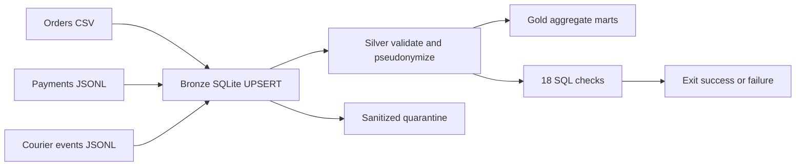

# Qafila Lakehouse — Data Engineering Capstone

**Submitted by:** @Shatha-algobaishi  
**Academy:** @SDAIAAcademy  
**Course:** Modern Data Engineering for AI Systems — SDAIA Academy

**Project type:** reproducible offline reference project for SDAIA Option 1 (Qafila Lakehouse). **Input data:** synthetic only. **Honest scope:** this is a complete, tested SQLite educational pipeline, **not an end-to-end run of the official SDAIA DuckDB/dbt/Iceberg starter**. That integration requires the course checkout and dependencies.

## Problem and outcome

An e-commerce operations team has separate order exports, payment API extracts and courier event feeds. This platform consolidates these sources into a repeatable quality-controlled analytical flow, producing daily sales by city, paid amounts by order and courier event counts. It illustrates how to detect errors, protect identifiers and avoid duplicate ingestion on reruns.

## Reproduce in one command

Python 3.10+ (standard library only):

```bash
python -m src.pipeline --demo
```

Run the 7 automated test scenarios (including 18 SQL quality rules):

```bash
python -m pip install -e '.[test]'
python -m pytest -q
```

Print the Gold tables:

```bash
python -m src.report
```

All generated database files are ignored by Git. For an explicitly provided local file export, set a non-demo token key:

```bash
export QAFILA_TOKEN_SALT='provide-a-private-random-secret'
python -m src.pipeline --input-dir /private/dataset --db artifacts/qafila.sqlite
```

The supplied CSV/JSONL schemas are intended for demonstration only; real source schemas require mapping and privacy review.

## Data sources and loading

| Source | Type | Grain | Refresh | Quality problem |
|---|---|---|---|---|
| orders.csv | Database-style CSV export | order | timestamp cursor + upsert | missing city / negative total |
| payments.jsonl | API-style JSONL export | payment | cursor + 48-hour lookback + upsert | sample P3 has negative amount |
| events.jsonl | Event JSONL replay | event | cursor + upsert | event type / unknown order |

No real database or HTTP endpoint is contacted. The JSONL files simulate extracted feeds. Older updates cannot overwrite newer records. The lookback is a deliberate bounded-lateness policy; backfills and deletions require additional CDC processing.

## Architecture



**Orchestration:** CLI stages run in order inside a transaction. An **optional** Dagster asset graph and 01:30 Asia/Riyadh schedule are provided in `src/dagster_app.py` (`pip install -e '.[orchestration]'`; `dagster dev -f src/dagster_app.py`). This optional stack has not been executed in the offline test environment.

## Data model / fact grain

| Table | Layer | Grain (one row per) | Key | Materialization |
|---|---|---|---|---|
| bronze_orders | Bronze | order | order_id | incremental upsert |
| bronze_payments | Bronze | payment | payment_id | incremental upsert |
| bronze_events | Bronze | courier event | event_id | incremental upsert |
| silver_orders | Silver | valid order | order_id | deterministic rebuild |
| silver_payments | Silver | valid payment | payment_id | deterministic rebuild |
| silver_events | Silver | valid event | event_id | deterministic rebuild |
| gold_daily_city_sales | Gold | update date and city | day,city | deterministic rebuild |
| gold_order_payments | Gold | order with paid payments | order_id | deterministic rebuild |
| gold_delivery_performance | Gold | event day and event type | day,event_type | deterministic rebuild |

## Quality, observability, governance

**18 executable quality checks** validate uniqueness, nulls, positivity, allowed values, referential integrity, reconciled totals, identifier isolation and quarantine hygiene. The included `P3` payment has a negative amount and is rejected to `quarantine` rather than being published. Quality outcomes and run metrics are recorded in SQLite. See `docs/GOVERNANCE.md` for the field classification table, access requirements and erasure process. Tokenization is not anonymization: Silver must still be access controlled.

## Evaluation evidence

The local sample produced **7 successful automated tests** and **18 passing data quality checks**, with **one synthetic invalid payment quarantined**. These results are generated on synthetic files and **must not be represented as execution against the original course dataset**. For commands and Q&A, see `docs/DEMO_SCRIPT.md`. The 8-slide presentation is in `docs/`.

## Official SDAIA course integration requirement

The authoritative course starter is [SDAIAAcademy/data-engineering/labs/capstone](https://github.com/SDAIAAcademy/data-engineering/tree/main/labs/capstone). It includes `pipeline.py`, `dbt_qafila`, a payment ODCS contract and Iceberg publication. **This repository does not include or claim to test the original full course stack.** To meet the original rubric as written, the team still needs to run and validate its actual Dagster/dbt/DuckDB/Iceberg flow, confirm the 8+ quality checks on the course data, and demonstrate the modifications in that environment. Do not submit this offline project as a verified replacement without performing those steps.

## Repo tree

```text
src/pipeline.py       Portable command-line pipeline
src/report.py         Gold tables + quality summary
src/dagster_app.py    Optional Dagster graph and schedule
data/                 Synthetic test inputs only
tests/                Six regression and integration tests
docs/                 Architecture, governance, live demo, slides
.github/workflows/    CI test workflow
```

## Limitations / next steps

SQLite is not equivalent to a DuckDB/Iceberg warehouse; the orders source is a CSV export rather than a connected OLTP DB; `updated_at` is a demo proxy for business order date; event-time windowing and SLA alerting are not implemented; and the optional Dagster definitions have not been installed and run here. At 100× volume, use partitioned parquet/Iceberg, a proper CDC mechanism, exact decimal currency, a transactional queue, and production secret management. These tradeoffs are deliberately disclosed rather than overclaimed.