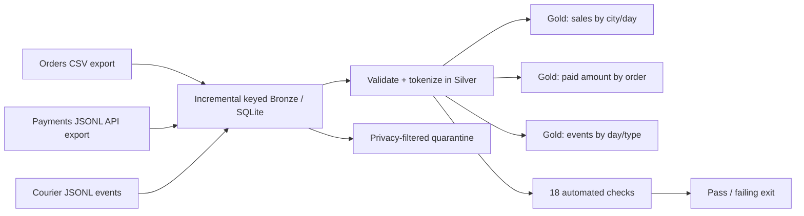

# Architecture and design decisions

## Implemented offline reference stack

- **Ingest:** per-source timestamp high-water mark, 48-hour lookback, keyed upsert. Replaying the same inputs does not add rows.
- **Store:** SQLite so synthetic demo runs without infrastructure or network. All persistent outputs are under `artifacts/` and ignored by Git.
- **Transform:** explicit Silver validation, deterministic full rebuild of derived tables, salted SHA-256 identifier tokenization.
- **Test:** 18 executable checks; transactional rollbacks; failed checks cause a nonzero CLI exit status.
- **Serve:** three Gold aggregated analytical tables queryable in SQLite.
- **Orchestrate:** command-line sequential execution; optional Dagster definitions in `src/dagster_app.py`, schedule 01:30 Asia/Riyadh.
- **Observe:** `pipeline_runs`, `quality_results`, source row counts, quarantine totals.
- **Govern:** segregate direct identifiers to Bronze, never publish real source files, rotate private token salt in deployments, review applicable NDMO/PDPL obligations.

## Relationship to the official SDAIA implementation

The course starter `labs/capstone/pipeline.py` uses DuckDB, Dagster, `dbt_qafila`, a payments contract and Iceberg publication. This independent offline reference implementation does **not** claim to replace, execute, or validate that stack. The original course repository and data are needed to test a genuine course-integrated deployment.

## Fact grain

| Table | Grain | Load |
|---|---|---|
| bronze_orders / silver_orders | one row per `order_id` | bronze upsert / silver deterministic rebuild |
| bronze_payments / silver_payments | one row per `payment_id` | bronze upsert / silver deterministic rebuild |
| bronze_events / silver_events | one row per `event_id` | bronze upsert / silver deterministic rebuild |
| gold_daily_city_sales | one row per order update date + city | rebuild |
| gold_order_payments | one row per order containing paid payments | rebuild |
| gold_delivery_performance | one row per event date + event type | rebuild |

## Known limitations

- Sales by `updated_at` is a demo proxy for order date. The course source has `created_at`, and a production model should use an immutable business event date.
- Monetary values use SQLite `REAL` for portability; production currency should use exact decimals / integer minor units.
- A bounded timestamp lookback cannot capture records later than that window; real CDC, periodic reconciliation and tombstone handling are needed.
- The local source format is an exported CSV, not a live database connector. The optional Dagster wrapper is not run in CI.
- The offline gold output is SQLite, not an Iceberg table, and no dbt execution is bundled.